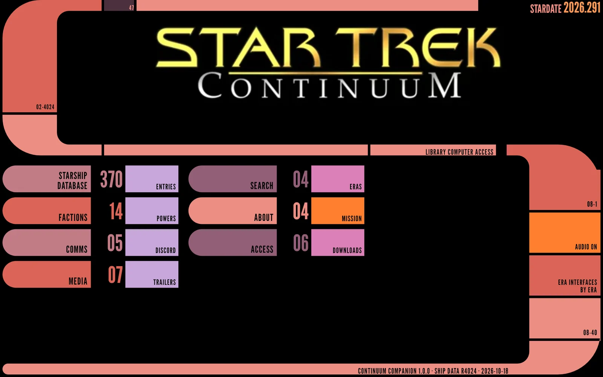
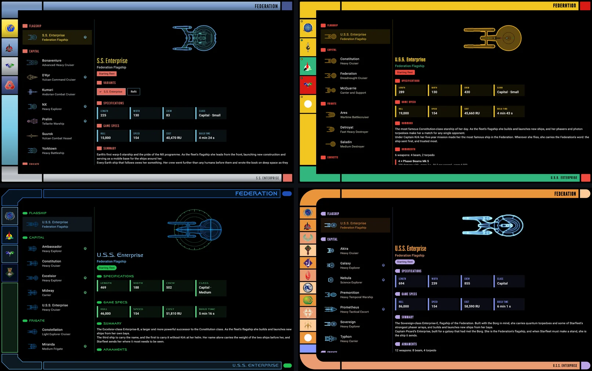
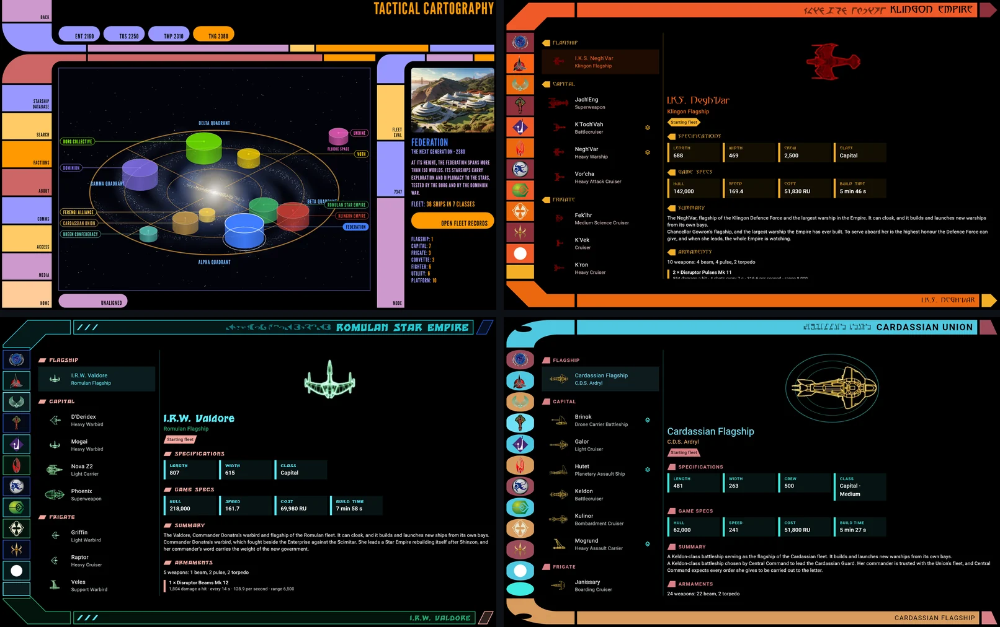
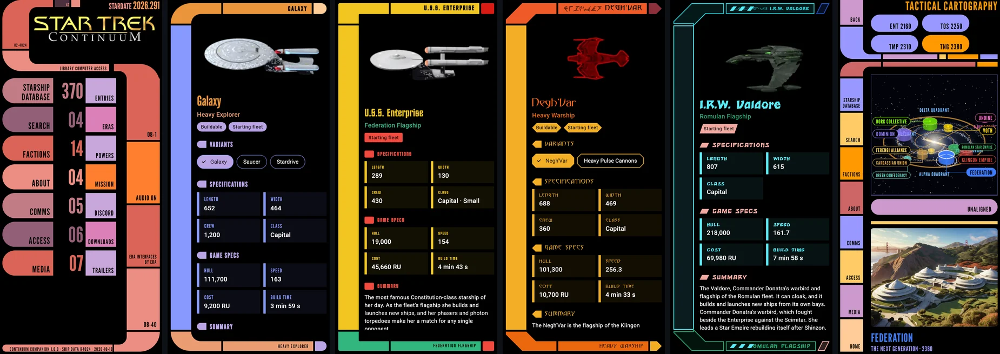
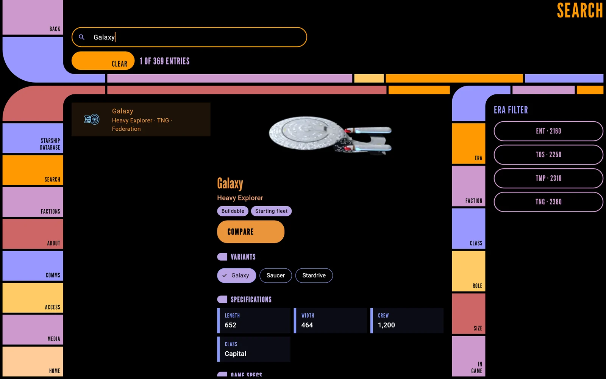

# Continuum Companion

The ship library for *Star Trek: Continuum Remastered*, the Homeworld Remastered mod: every ship across the Enterprise, Original Series, Motion Picture and Next Generation eras, in an interface modelled on the shows' own displays. Built in Flutter for Android and Windows.

**[Download it from Releases](../../releases)**: a Windows installer or portable zip, and Android APKs. Install steps are in [Release Notes](docs/Release-Notes.md).



## What's in it

- **Starship Database.** 370 ships across four eras and 14 factions, each era and faction in its own interface after the shows: TNG LCARS, the film-era consoles, Klingon, Romulan, Cardassian, Dominion, Borg and more.
- **Ship pages.** A turntable of the in-game model, specifications, armaments with each weapon's figures, research, abilities, notable ships with their registries, where the class comes from in canon, and the model's credits.
- **Search and Compare.** Find any ship by name, class, hull or registry, filter by era, faction, class and role, and set any two side by side.
- **Factions.** A tactical star chart of the galaxy, with each power at its size in the era chosen, and a homeworld scene and short history for each.
- **Offline, touch and keyboard.** Everything ships with the app; it works with touch on a phone and with mouse and keyboard in a window, with screen reader labels and large text throughout.

## A look round

Each era has its own interface, after the shows: the Enterprise-era panels, the Original Series consoles, the film-era displays and TNG LCARS.



The other powers have theirs: a tactical star chart of the galaxy, and the Klingon, Romulan and Cardassian fleets, each with its own script beside the title.



On a phone, each ship page opens on a turntable of the in-game model you can drag round.



Search finds a ship by name, class, hull or registry, with filters for era, faction, class and role, and the ship's page beside the results.



## Repository

| Path | Contents |
|---|---|
| `app/` | The Flutter app |
| `pipeline/` | The Python tools that build the ship data and turntable renders from the mod's files |
| `data/` | Hand-authored sources for the pipeline: themes, credits, canon links, registries |
| `docs/` | The design notes and wiki, starting at [Home](docs/Home.md) |
| `installer/`, `tools/` | Windows packaging (NSIS) and app icons |

### Building the app

You'll need the Flutter SDK, plus Android Studio for Android or Visual Studio's "Desktop development with C++" workload for Windows.

```bash
cd app
flutter test
flutter run -d windows
```

The data and renders are already in `app/assets`. Rebuilding them (`pipeline/rebuild.py`) needs the mod's source files and Blender, which aren't part of this repository; the [Pipeline](docs/Pipeline.md) page explains the steps.

A build from here uses the platform font where the released app uses Star Trek fan fonts; see [NOTICE](NOTICE.md).

## Licence

The code is under the [MIT licence](LICENSE). The mod's content, the ship renders and the fan art are not; [NOTICE](NOTICE.md) says what's covered.

This is an unofficial fan work, not endorsed by CBS Studios, Paramount or any Star Trek rights holder. Ship data and art come from *Star Trek: Continuum Remastered* by the Continuum team, and ship models are by the authors credited in the app.
